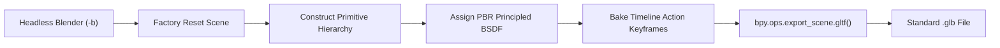
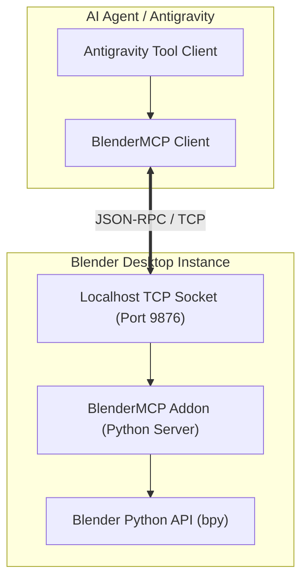

# BlenderMCP & Headless Asset Pipeline Architecture (Phase B9)

**Subsystem:** `video-gen/blocky/`  
**Pipeline Tier:** Tier C (Blender Asset/Animation Factory $\to$ Three.js Deterministic Runtime)  
**Governing Principle:** *Model/animate in Blender, export glTF 2.0, film in Three.js.*  

---

## 1. The Core Architectural Rule

> [!IMPORTANT]
> **Never render final video frames in Blender for daily Shorts production.**
>
> - **EEVEE** requires an interactive GPU display/OpenGL window context, making it fragile in headless CI/CD, Docker, and remote build servers.
> - **Cycles** on CPU takes 40–120 seconds per frame (12 to 36 hours for a 35s short).
> - **Three.js Hardware Rasterization** renders 1080×1920 frames in **80 ms** (~12.5 fps), runs cleanly in headless Chromium with only **135 MB RSS**, and guarantees 100% deterministic frame output via `window.seek(t)`.

Blender's sole role in the Blocky Story Engine is as an **asset and animation factory**:
- High-detail polygonal modeling
- Skeletal rigging & weight painting
- Facial shape keys (visemes, expressions)
- Kinematic walk/run/jump action baking
- Exporting self-contained binary glTF (`.glb`) containers

---

## 2. Headless Asset Export Protocol (`blender -b -P`)

Assets can be generated or converted from `.blend` sources completely headlessly without launching the GUI:

```bash
# Run headless Blender script with arguments
blender -b -P blocky/tools/make_asset.py -- --asset trophy --out blocky/assets/models/hero_trophy.glb
```

### Script Execution Lifecycle


When Blender is not installed, `blocky/tools/make_asset.py` automatically falls back to native standalone glTF 2.0 binary synthesis, producing identical byte-accurate `.glb` files with zero external dependencies.

---

## 3. BlenderMCP Integration Architecture

For interactive AI pair-programming and automated DCC control, the engine integrates with **BlenderMCP** using a lightweight local JSON-RPC socket server running within a Blender addon.



### Socket Server Protocol
The BlenderMCP addon listens on `localhost:9876`:
- **Request Format**:
  ```json
  {
    "id": "req-001",
    "method": "execute_code",
    "params": {
      "code": "bpy.ops.mesh.primitive_cube_add(size=2.0); obj = bpy.context.active_object; obj.name = 'HeroBox'"
    }
  }
  ```
- **Response Format**:
  ```json
  {
    "id": "req-001",
    "result": {
      "status": "success",
      "output": "Created object HeroBox",
      "selected_objects": ["HeroBox"]
    }
  }
  ```

### Key BlenderMCP Remote Commands
1. `blender.inspect_scene`: Returns hierarchy tree, active materials, and object bounding boxes.
2. `blender.create_mesh`: Instantiates low-poly meshes with vertex color groups.
3. `blender.bake_action`: Bakes armature constraints down to NLA action tracks.
4. `blender.export_gltf`: Headlessly writes the final model and clips to `blocky/assets/models/`.

---

## 4. Deterministic Playback Contract in Three.js

Exported animations must remain deterministic under the `window.seek(t)` engine contract.

```javascript
import { GLTFLoader } from 'three/examples/jsm/loaders/GLTFLoader.js';
import { GltfAsset } from './runtime/gltf_asset.js';

// 1. Load GLB binary buffer
const arrayBuffer = await fetch('assets/models/hero_trophy.glb').then(r => r.arrayBuffer());

// 2. Instantiate GltfAsset wrapper
const trophy = await GltfAsset.parseFromBuffer(arrayBuffer, THREE, GLTFLoader);
scene.add(trophy.root);

// 3. Inside window.seek(t): Pure function of time
function seek(t) {
  // Sets animation pose strictly by timestamp t — zero frame drift
  trophy.seek(t);
  
  renderer.render(scene, cam);
}
```

By enforcing `mixer.setTime(t % clipDuration)` rather than advancing delta time (`mixer.update(dt)`), seeking backward, jumping to arbitrary frames, and parallel multi-worker rendering are guaranteed to produce identical pixels every time.

