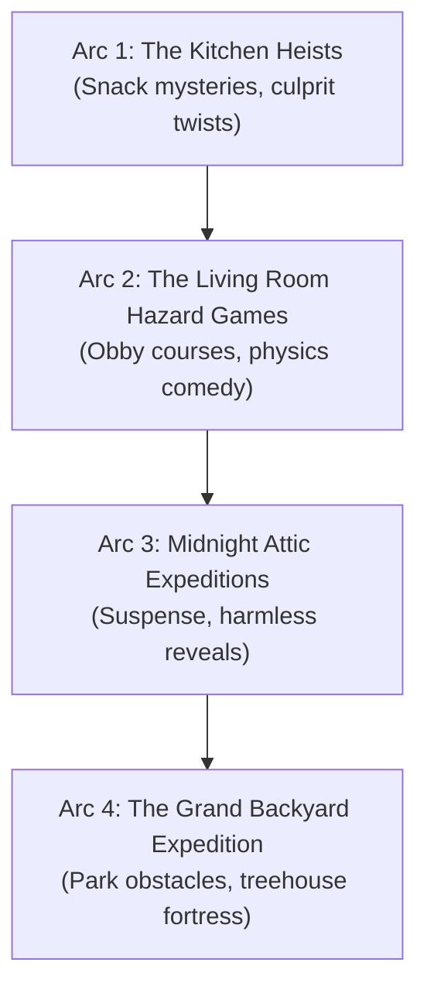

# THE BLOCKIES — Season 1 Narrative Arcs & Series Bible

## 1. Concept & Channel Identity
*The Blockies* is an original 3D animated episodic comedy short series built completely procedurally with blocky, stylized low-poly characters. It combines fast physical comedy, child-friendly mystery deduction, and high-energy obstacle course action tailored specifically for YouTube Shorts and Instagram Reels (9:16 vertical format, 30–45s per short).

### Channel Core Tenets:
1. **Original IP**: Never reference or simulate copyrighted or trademarked sandbox game avatars, assets, sounds, or terminology (zero mentions of "Roblox", "Minecraft", "Blox", "Robux", etc.).
2. **Kid-Safe & Family-Friendly**: Designed from the ground up to comply with YouTube's *Made for Kids* guidelines—free of horror, violence, cyberbullying, romantic drama, or dangerous stunts.
3. **High-Retention Pacing**: A visual event or camera punch occurs every 1.5–2.5 seconds, anchored by a strong, non-greeting hook line in the first 1.5 seconds.
4. **Anti-Repetitive Continuity**: Recurring characters (Pip, Mox, June) with memory across episodes, evolving running gags, and diverse environments (kitchen, obby course, haunted attic, park, bedroom, hallway).

---

## 2. Character Triad & Dynamics

### Pip (The Overthinking Detective)
- **Voice**: Adam (`sid: 5`, speed: 1.05)
- **Role**: Narrator, strategist, note-taker.
- **Dynamic**: Takes everyday minor household mysteries with extreme gravity. Confident in his deductive reasoning until his own clues dismantle his theories.
- **Catchphrase**: *"Okay, hear me out."*

### Mox (The Panicked Stuntman)
- **Voice**: Nicole (`sid: 2`, speed: 1.10)
- **Role**: Impulsive best friend, physical comedian.
- **Dynamic**: Highly emotional, easily terrified by harmless coincidences, but surprisingly lucky during physical stunts. Always shouts his defense before anyone even asks.
- **Catchphrase**: *"I was NOT there!"*

### June (The Baby Genius Mastermind)
- **Voice**: Sky (`sid: 4`, speed: 1.15, high pitch)
- **Scale**: 0.4 (half-height toddler proportion)
- **Role**: Wildcard strategist, builder, snack confiscator.
- **Dynamic**: Operates from concealed corners (under tables, inside chests, behind vents). Re-labels all mischief as rigorous scientific trials.
- **Catchphrase**: *"It was purely for research."*

---

## 3. Season 1 Story Arcs

### Arc 1: The Kitchen Heists (Episodes 1–4)
- **Focus**: Who ate the baked goods? Pip builds elaborate detective maps; Mox gets accused; June leaves breadcrumb trails leading into unexpected hiding spots.
- **Theme**: Jumping to conclusions and finding humor in sibling squabbles.

### Arc 2: The Living Room Hazard Games (Episodes 5–8)
- **Focus**: The classic "Floor is Lava" transformed into a high-stakes neon obstacle course with rotating hazard spinners and stepping stones.
- **Theme**: Courage, physical comedy, and ridiculous improvised solutions (e.g., rubber duck buoyancy).

### Arc 3: Midnight Attic Expeditions (Episodes 9–12)
- **Focus**: Bizarre creaks, flashing neon lights, and glowing storage trunks in the dusty upstairs attic.
- **Theme**: De-bunking scary myths; reveals that June transformed the storage attic into a miniature game arcade.

---

## 4. Continuity Rules & Callbacks
1. **The Snack Debt**: Snacks mentioned as missing in one episode reappear as props or bartering tools in subsequent episodes (e.g., the missing chocolate cake from Ep 1 becomes June's arcade energy source in Ep 3).
2. **Mox's Lucky Duck**: Mox's emotional support rubber duck is a recurring talisman across all hazard courses.
3. **June's Expanding Bases**: June starts with an outpost under the kitchen table, then expands to the attic, and later the backyard doghouse.
